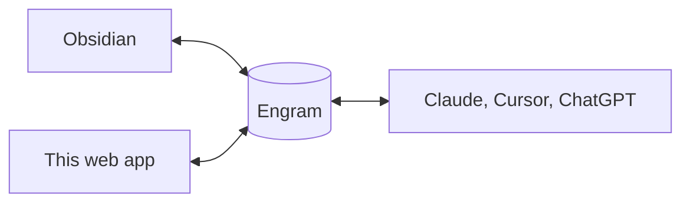

---
tags:
  - example
created: 2026-11-08
done: false
---

## Try these

- [ ] Click this line. You're editing — no save button, it syncs as you type.
- [ ] Type `[[` anywhere to link another note. That note gets a **Backlinks** entry pointing back here.
- [ ] Add `#example` to any line. Tags filter across folders; a note can carry as many as you like.
- [ ] Open **search** in the sidebar, then try a phrase you never typed — it matches meaning, not keywords.
- [ ] Tick one of these boxes. Task lists are just `- [ ]`.

## Where your notes live



One vault, three doors. Edit in any of them and it shows up in the others — no export step, no second copy. Same files, same bytes.

## Properties

The fields above this note's text are its [frontmatter](https://obsidian.md/help/properties): plain [YAML](https://learnxinyminutes.com/yaml/) in the file, editable fields here. To add them to a note that has none, type `---` on the very first line, or open the kebab menu (`⋮`) and pick **Add property**.

| Type | Example |
| --- | --- |
| `text` | `status: draft` |
| `list` | `tags: [example]` |
| `number` | `priority: 2` |
| `checkbox` | `done: false` |
| `date` | `created: 2026-09-02` |
| `datetime` | `due: 2026-09-02T17:00` |

## Reading, editing, and the source

The ✏️ button in the header flips between editing and reading, and it shows the mode you are **in** — a pencil means you're editing, a book means you're reading. Flip back and you land in whichever editor you left, not a default.

The kebab names all three, with the same icons, so you can jump straight to one:

| Icon | Mode | What you get |
| --- | --- | --- |
| ✏️ | **Edit** | Live preview: `**bold**` becomes **bold** as you type. This is the default. |
| `</>` | **Raw** | The plain source: `**bold**` stays `**bold**`, and the properties above turn back into YAML text. |
| 📖 | **Reading** | Read-only. No cursor to nudge anything out of place. |

> [!tip] Finish setup
> The panel in the bottom right walks you through connecting Obsidian and your AI tools. It disappears once you're done. Full guides: [engram.page/docs](https://engram.page/docs)

The rest of what you'd expect works too — ~~strikethrough~~, `inline code`, KaTeX like $e^{i\pi} + 1 = 0$, and fences with syntax highlighting:

```python
def remember(thought: str) -> None:
    # Anything you write here, your AI tools can read.
    vault.write(thought)
```

Delete this note whenever — it's only markdown.
